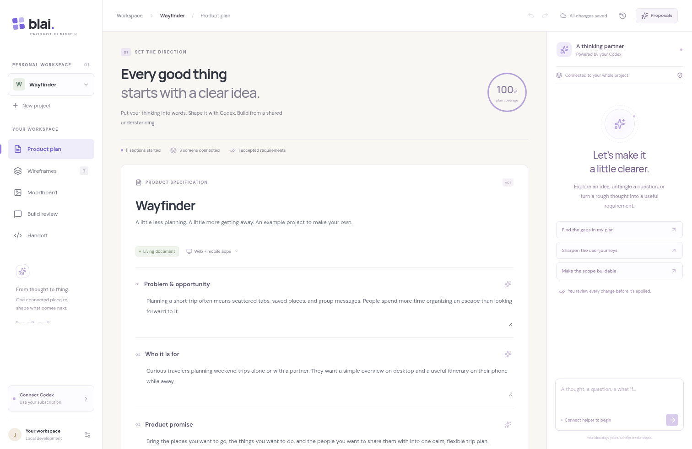

# BLAI Product Designer

A connected studio for turning a product idea into a specification Codex can build. Write the plan, shape editable wireframes, collect visual references, annotate decisions, and export the whole picture.



Also see the [wireframe editor](docs/screenshots/wireframes.png) and [handoff workspace](docs/screenshots/handoff.png).

## First pass

- **Product planning:** an editable, structured specification beside a Codex conversation. AI changes arrive as proposals with current/proposed plan text, inspectable screen structure, and visible color/type/radius changes before applying.
- **Wireframes:** nested rows, columns, cards, text, buttons, and other components; drag ordering, cross-screen copy/paste, keyboard editing, parent/layout controls, desktop/mobile screens, explicit state variants, and clickable navigation.
- **Automatic overview:** one click visualizes the existing plan, written journeys, screen connections, decisions, comments, and references. Explore original sources and return to edit them; no diagram authoring or AI connection is required. See [the overview and screenshots](docs/PELE-EXPERIMENT.md).
- **Moodboard and build review:** image uploads, HTTPS image/webpage references, source notes, and screenshot review.
- **Annotations:** normalized pins with dotted connectors, threaded replies, resolve/reopen, and conversion to accepted requirements. Notes from removed targets remain in project discussion with their previous location.
- **Handoff:** ZIP with a `CODEX.md` implementation entrypoint, Markdown, structured project data, screen SVGs, assets, checksums, accepted requirements, and unresolved questions. Optional atomic GitHub export preserves unrelated repository files.
- **Persistence:** private projects in D1, images in R2, automatic revisions, session undo/redo, named checkpoints, and conflict recovery with downloadable local drafts.
- **Codex subscription:** the shared BLAI Helper manages Designer, Writer, and future tool adapters in one Linux service using an existing ChatGPT Codex login and outbound polling. Each tool keeps its own private settings and queue.

The included **Wayfinder** project is a clearly labeled, editable example. AI is never simulated in the application: an offline helper produces an explicit connection state, not fabricated output.

## Run locally

Use Node 24 (tested with 24.19.0) and npm. Dependencies are pinned in `package-lock.json`.

```bash
npm ci
test -f .dev.vars || cp .dev.vars.example .dev.vars
npm run db:local
npm run dev
```

Create `.dev.vars` only if it does not already exist; preserve any existing configuration. Local development uses Cloudflare's real Worker, D1, and R2 emulators. The application runs on port 5173. Local authentication requires both `DEV_AUTH=local` and a loopback hostname; production requires Cloudflare Access.

In a restricted cloud workspace with a read-only home directory, use:

```bash
export XDG_CONFIG_HOME=/tmp/blai-xdg
export npm_config_cache=/tmp/blai-npm-cache
export CLOUDFLARE_SEND_METRICS=false
npm ci
npm run db:local
npm run dev
```

Each Codex cloud task already has an isolated checkout. Use the existing repository; creating another Git worktree is unnecessary.

## Validate

```bash
npm run typecheck
npm test
npm run test:helper
npm run build
```

With the development server running:

```bash
PLAYWRIGHT_CHROMIUM_EXECUTABLE=/usr/bin/chromium npm run test:e2e
```

The five browser workflows create and remove their own projects. The same workflows are configured in GitHub Actions alongside unit/helper tests, formatting, and the production build. They exercise autosave, project switching, checkpoints, ZIP downloads, layout editing, real drag operations, prototype navigation, R2 uploads, pinned comments, accepted requirements, delayed-upload regressions, in-flight undo, revision conflicts, proposal diffs, and stale checkpoint responses. Set `BLAI_TEST_URL` for another local test server and `PLAYWRIGHT_CHROMIUM_EXECUTABLE` for another Chromium installation.

Unit and integration tests include real local D1/R2, owner isolation, Access authentication, concurrency, helper leases/cancellation, stale AI proposals, imported URL validation, and GitHub API fixtures. Fixtures validate the protocol; they do not establish a live Codex subscription connection or a real GitHub write.

## Editing shortcuts

Use the toolbar to undo/redo changes across the workspace. Outside text fields, `Ctrl/⌘ Z` undoes and `Ctrl/⌘ Shift Z` redoes. Text fields retain their native editing shortcuts. Session history holds up to 50 edits subject to a memory budget, resets when switching projects or reloading, and does not replace named checkpoints.

When the wireframe canvas or layers have focus, `Ctrl/⌘ C` copies a component, `Ctrl/⌘ V` pastes it into the selected container (including across screens), and `Ctrl/⌘ D` duplicates it. Delete/Backspace removes the selected component. The inspector's parent and layout controls move and reshape components while keeping pinned comments attached.

When another tab saves a newer revision, your edits remain visible. Download the unsaved copy before choosing **Reload saved version** if you want to keep both versions. A pending upload is not added during a project replacement; the board reports that it was not attached so it can be uploaded again.

## Deploy to Cloudflare

The application is prepared for a **new** Worker, D1 database, R2 bucket, and Access application. Deployment credentials and resource IDs are intentionally absent from the repository.

1. Authenticate Wrangler to the intended Cloudflare account.
2. Create the resources:

   ```bash
   npx wrangler d1 create blai-designer
   npx wrangler r2 bucket create blai-designer-assets
   ```

3. Replace the placeholder `database_id` in `wrangler.jsonc` with the new D1 ID. Set the intended Worker name/domain and account selection as needed.
4. Create a Cloudflare Access application for the designer. Allow your Google/email identity and create a separate service-token policy for the designer helper's `/api/codex` route.
5. Configure these Worker settings through Cloudflare or `wrangler secret put`:

   | Name                            | Purpose                                                                      |
   | ------------------------------- | ---------------------------------------------------------------------------- |
   | `CF_ACCESS_TEAM_DOMAIN`         | Your Access team domain, such as `team.cloudflareaccess.com`                 |
   | `CF_ACCESS_AUD`                 | The designer Access application's audience                                   |
   | `AUTH_ALLOWED_EMAILS`           | Comma-separated allowed email identities                                     |
   | `DESIGNER_OWNER_EMAIL`          | The identity that owns the helper queue and can download its setup           |
   | `DESIGNER_BRIDGE_SECRET`        | A new random, printable ASCII bridge secret of at least 32 characters        |
   | `DESIGNER_ACCESS_CLIENT_ID`     | The designer helper's Access service-token ID                                |
   | `DESIGNER_ACCESS_CLIENT_SECRET` | Its Access service-token secret                                              |
   | `GITHUB_TOKEN`                  | Optional token with permission to update the chosen specification repository |

6. Keep current `BLAI`, `ai-writing-tool`, and `BLAI-product-designer` checkouts beside each other. `npm run build:release` builds the app and packages the shared `blai-helper.tar.gz` download from those repositories. `npm run deploy` uses this release build automatically. Apply the production schema and deploy:

   ```bash
   npx wrangler d1 migrations apply blai-designer --remote
   npm run deploy
   ```

7. Sign in and open **Connect Codex**. Download BLAI Helper and the private Designer settings, then follow [the Linux setup and migration guide](docs/CODEX-HELPER.md). If the manager is already installed, import Designer settings into it. The shared `blai-helper.service` manages both tools using the existing Codex CLI and ChatGPT sign-in, with separate private profiles. Import the existing Writer settings before migration to include Writer in the same service.

No Codex login credentials are uploaded to Cloudflare. Helper setup downloads are owner-only, are not cached, and should be kept out of Git. The `.blai-designer/` configuration directory and local environment files are ignored.

## Current limits

- Live Cloudflare publication, the user's Linux helper, and real GitHub publishing require the deployment configuration above. These are not activated by a successful local build.
- **Image generation:** current official Codex source includes subscription-backed image generation, but its artifact integration could not be verified in this cloud runtime. The first pass supports uploaded/imported images and AI-written visual directions; it does not advertise a working image-generation capability or add a paid API fallback. See the evidence in the helper guide.
- SVG handoff previews are illustrative layouts. Image components remain labeled placeholders; uploaded originals are bundled separately with provenance.
- Internet image imports require the chosen HTTPS host and `cloudflare-dns.com`; GitHub export requires `api.github.com`. A managed development environment may need those destinations added to its network policy. Production Worker egress uses Cloudflare's networking.
- This is a personal workspace. Public signups, live multiplayer, and automatic live-app screenshot capture are outside this first pass.

## Project notes

- [The 16 product decisions](docs/DECISIONS.md)
- [Architecture and API contract](docs/API-CONTRACT.md)
- [Codex Helper setup and protocol](docs/CODEX-HELPER.md)
- [Handoff formats and GitHub behavior](docs/HANDOFF.md)

The subscription/helper architecture follows the user's [AI writing tool](https://github.com/JoDavidsson/ai-writing-tool), inspected at commit `655415110c8b23e0b9b83f2ec5b19b9cd3c4c62f`.
