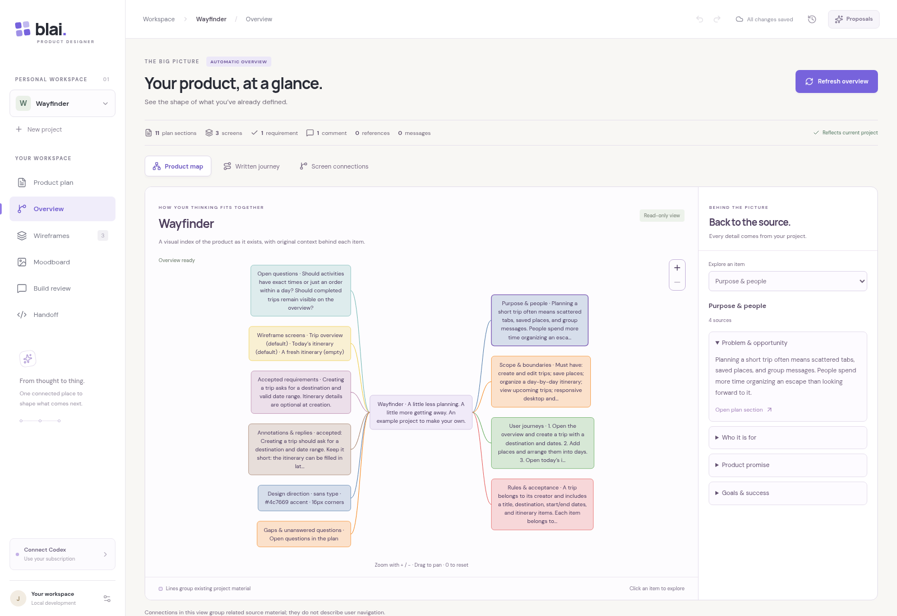
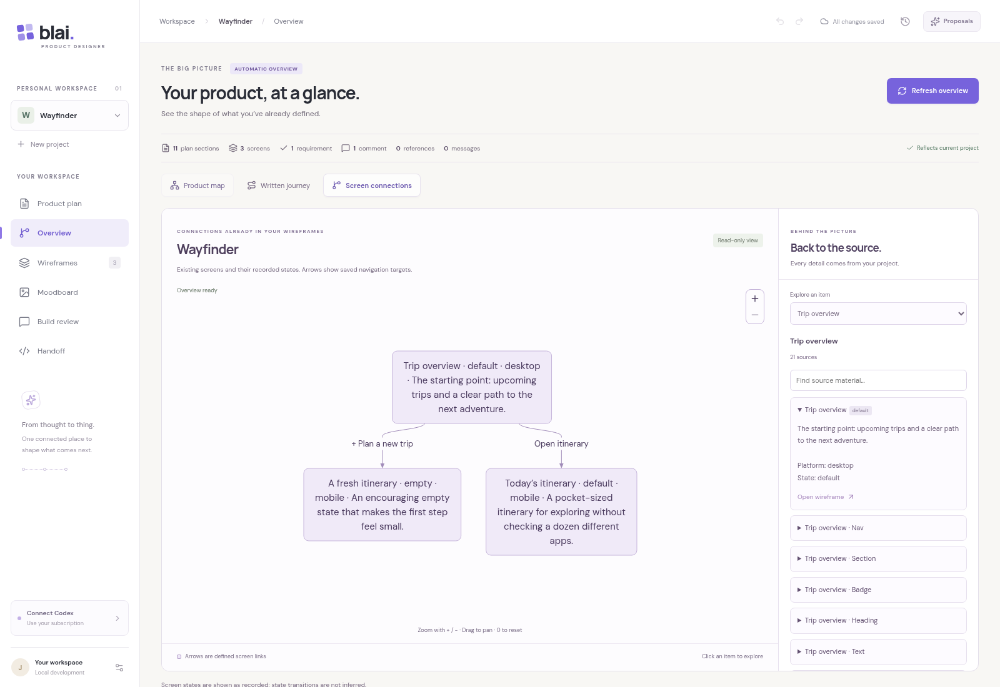

# Automatic product overview

[Review the running-app screenshots below](#screenshots). Pele draws an automatic view of the product that already exists. Users never write diagram syntax, maintain a separate diagram, or generate new product decisions through this workspace.

## Try it

1. Open a project with a product plan, wireframes, or other material.
2. Select **Visualize product** on the plan page, or open **Overview** and select the button there.
3. Explore **Product map**, **Written journey**, and **Screen connections**. Select a diagram item or use the **Explore an item** dropdown to read its full original sources.
4. Use **Open plan section**, **Open wireframe**, or another source link to return to the original item. Plan sections, components, requirements, discussions, references, and conversation messages keep their original locations.
5. Edit the original material and return to Overview. The picture reflects the current project automatically. **Refresh overview** also redraws it on demand. Zoom buttons, `+` / `−`, Ctrl/⌘ + scroll, drag, arrow keys, and `0` support larger maps.
6. Download the handoff. Its three overview files and source index are rebuilt from the saved project every time, even if Overview was never opened.

Viewing, selecting, zooming, refreshing, and navigating through the overview do not change project content or revisions. Only a project-specific session preference remembers that the overview was opened; no duplicate specification or generated SVG is saved. The feature works without an AI/helper connection.

## What the picture means

- **Product map:** groups existing plan sections, screen/component definitions, accepted and proposed requirements, annotations/replies, image references, conversation history, and design settings. Labels contain short excerpts; the inspector keeps the complete source text. Grouping lines describe organization, not behavior or approval.
- **Written journey:** shows explicitly numbered items in their written order. Numbering does not establish a transition between independent journeys. Arbitrary prose stays quoted context; the app does not invent actions or guess their order. Separate numbered lists remain separate.
- **Screen connections:** shows actual screens and state labels. Arrows come only from existing component navigation targets. It does not infer links from screen names or turn loading/empty/error variants into invented transitions.
- **Things to look at:** points out recorded open questions and missing source connections. These are observations, not newly approved requirements.

Large collections are grouped for readability; all entries remain available through the source inspector/search. Long numbered lists show the first 22 items individually and retain later items in a labeled group. Screen navigation drawings are limited to 150 arrows; the details retain every original action. These limits are disclosed beside the diagram when reached.

Legacy manual diagram drafts from the initial experiment remain preserved in project data and exports for compatibility. They are excluded from the automatic overview and have no authoring interface.

## Screenshots

Actual Chromium captures at 1600 × 1100 using the existing editable Wayfinder sample. The diagrams were derived by clicking **Visualize product**. The capture verifies the original project JSON and revision are unchanged, then deletes its temporary fixture.

## Implementation

`shared/overview.ts` is a pure, deterministic projection of the project with source references. It is shared by the browser and handoff exporter. Mermaid is an internal generated representation; no application input accepts it. `src/lib/diagrams.ts` renders with pinned `pele@1.6.0`, loading only mindmap and flowchart types in the lazy Overview workspace. The Worker builds text/source files and does not bundle the renderer.

Generated labels and IDs are encoded, and external links/images are disabled. Project content cannot supply render options, HTML, icons, or click handlers. Application-owned SVG node handlers select matching source records; navigation is resolved against the current project's records. Rendering has bounded labels, graph sizes, a 65,536-character source limit and 1 MB output limit. Source text is displayed by React as text. The MIT/ISC notices remain in `public/licenses/pele.txt` and the built assets.

Browser tests cover automatic generation, original-content/revision preservation, source navigation, live source edits, reloads, project isolation, empty projects, hostile labels, zoom, handoff output, and narrow layouts. Unit tests cover all source categories and statuses, deterministic output, conservative journey parsing, explicit-only navigation, complete grouped source coverage, legacy compatibility, and export provenance. See [validation](VALIDATION.md) and [handoff details](HANDOFF.md).
