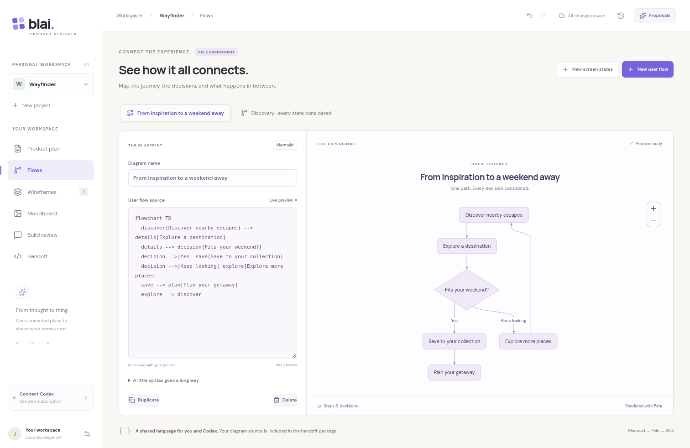
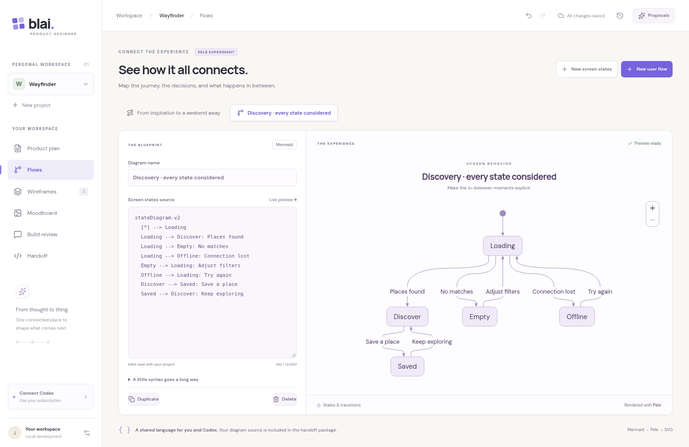

# Pele experiment

This branch evaluates [Pele](https://pele.run/) as a renderer for user flows and screen states alongside BLAI's editable wireframes. It uses `pele@1.6.0`, pinned in the lockfile, with only the flowchart and state diagram types. The workspace loads when **Flows** is opened; the renderer is not part of the initial application bundle.

## Try it

1. Run the app using the README's local instructions and open **Flows**.
2. Choose **New user flow** or **New screen states**. These are editable examples, not AI output.
3. Rename the diagram and edit the Mermaid source. The preview updates after a short pause. Use the zoom buttons, `+` / `−`, or Ctrl/⌘ + scroll to enlarge it; drag or use arrow keys to pan. `0` resets the view.
4. Try an incomplete statement. The error appears as text, the invalid draft remains saved, and fixing it restores the preview.
5. Reload, switch projects, duplicate/delete a diagram, or undo an edit. Diagrams use the existing project persistence and history.
6. Download the specification from **Handoff**. Each diagram appears as exact Mermaid source in `diagrams/{id}.mmd`, plus structured metadata and checksums.

The current helper receives diagrams as project context. This experiment does not add AI diagram generation, node dragging, linked screen navigation, or diagram comment pins. Those need separate product decisions. Wireframes retain their existing component editing and annotations.

## Screenshots

These are Chromium captures of the running application using a temporary Wayfinder example, with diagram text edited through the UI. They are not mockups. The fixture was removed afterward.

## Integration choices

- Mermaid text is the portable source of truth. Generated SVG is never saved to the project. `src/lib/diagrams.ts` contains the replaceable rendering adapter.
- Old projects without a `diagrams` field continue to load. A project supports 12 diagrams, 120-character names, and 12,000 characters per source. The usual whole-project storage limit still applies.
- Only registered flowchart/state renderers are available. Rendering uses a 1 MB SVG output limit and 150-edge flowchart limit. Pele's edge limit does not apply to state diagrams. Rendering runs in the browser with debouncing; a worker timeout would be appropriate before supporting much larger diagrams.
- Links and images are disabled. No icon resolver or user-provided rendering options are accepted. Pele escapes labels; React renders error messages as text. Browser tests exercise hostile labels, click directives, and remote image syntax.
- Pele owns only its SVG/zoom subtree. React cleans up zoom listeners and observers on re-render and unmount. Styling uses CSS custom properties.
- Handoff exports all Mermaid drafts exactly, including unfinished syntax. The guide identifies them as design context, not accepted requirements. The Worker neither parses nor renders Mermaid; diagram previews are not exported as SVG in this experiment.
- The package is new, so keep the exact pin and run diagram regressions before an upgrade. Its MIT license and bundled Lucide ISC notice are retained in [`public/licenses/pele.txt`](../public/licenses/pele.txt) and included in the built site's assets.

## Checks

`tests/e2e-flows.mjs` exercises the real browser renderer, autosave/reload, both diagram kinds, invalid drafts, recovery, zoom, undo, duplicate/delete, project isolation, ZIP contents, hostile markup, and narrow layouts. It runs with the existing browser workflows via `npm run test:e2e`.

Unit/helper tests cover source limits, type mismatch, legacy project compatibility, identifier collisions, AI proposal preservation, exact UTF-8 source export, checksums, and GitHub ownership/stale-file behavior. See [validation](VALIDATION.md) for the completed checks and external limitations.
